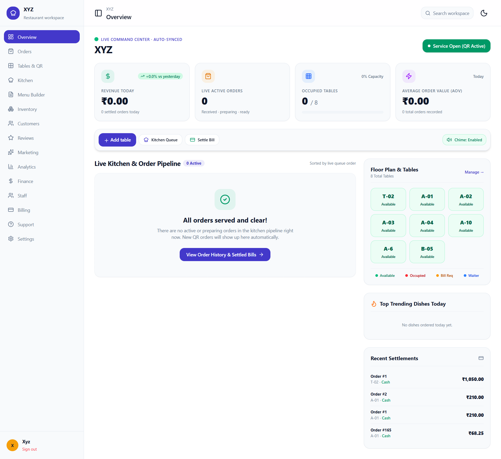
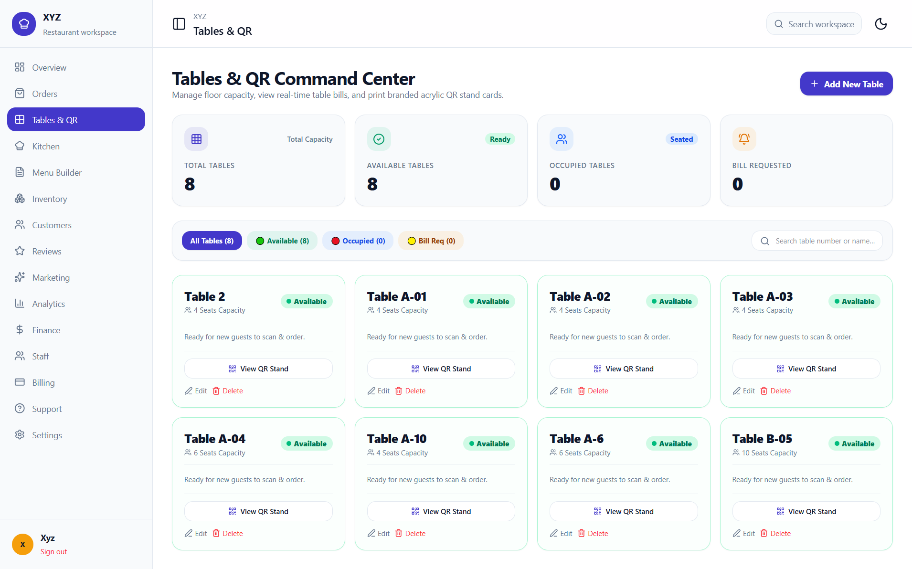
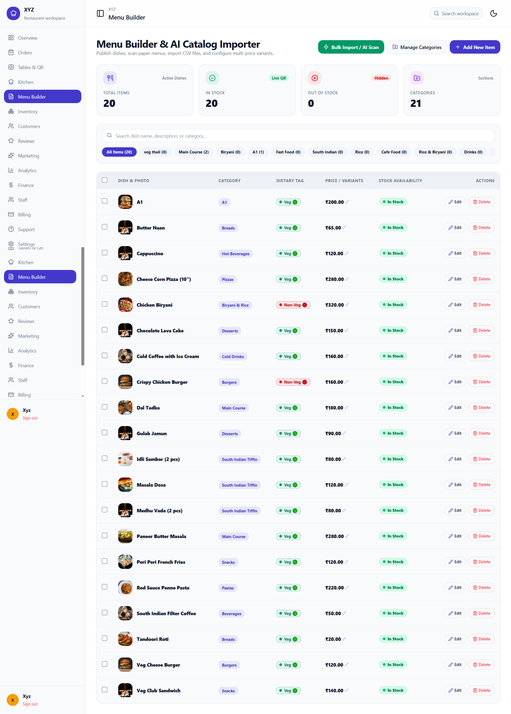
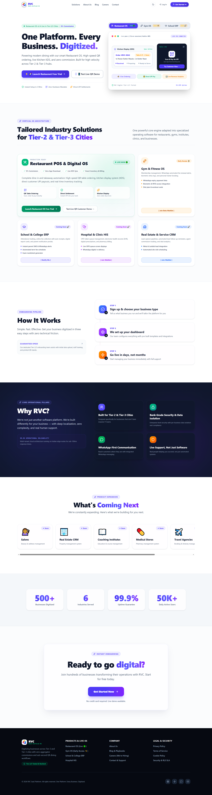
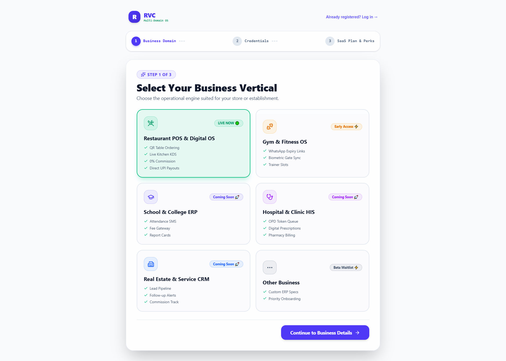
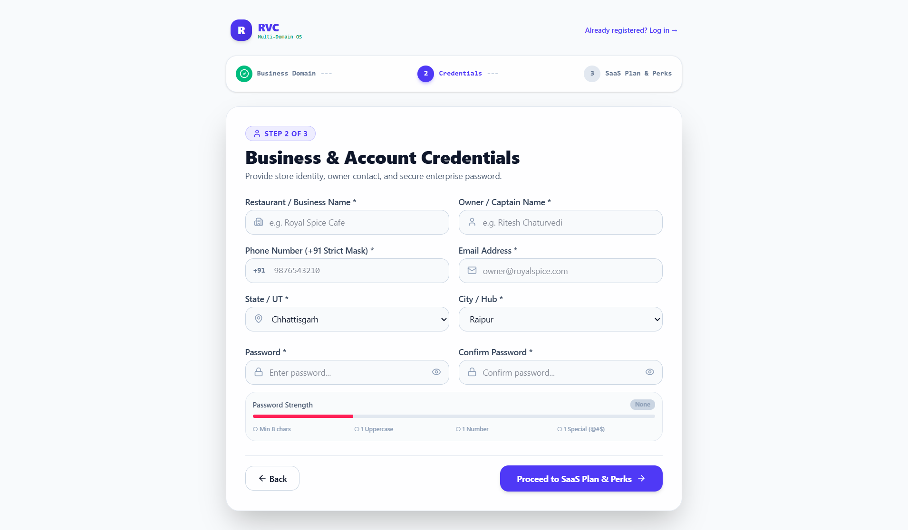
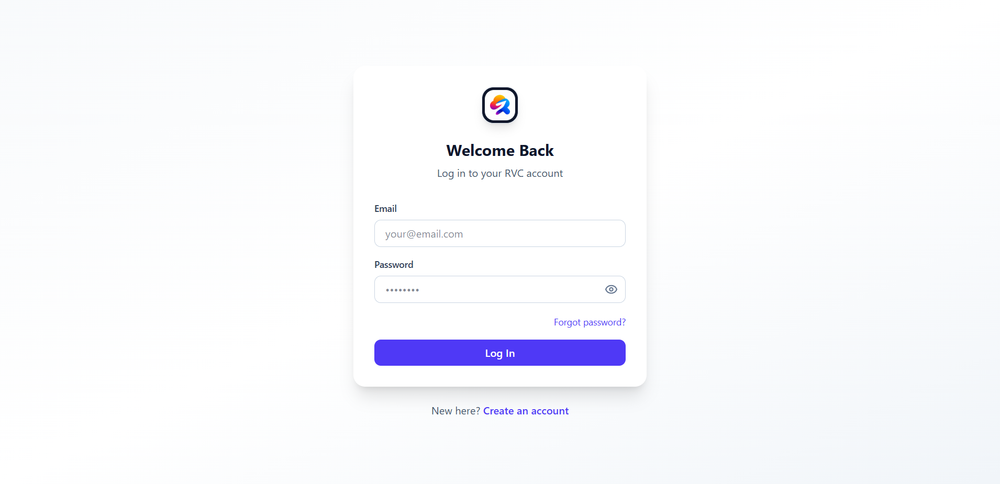
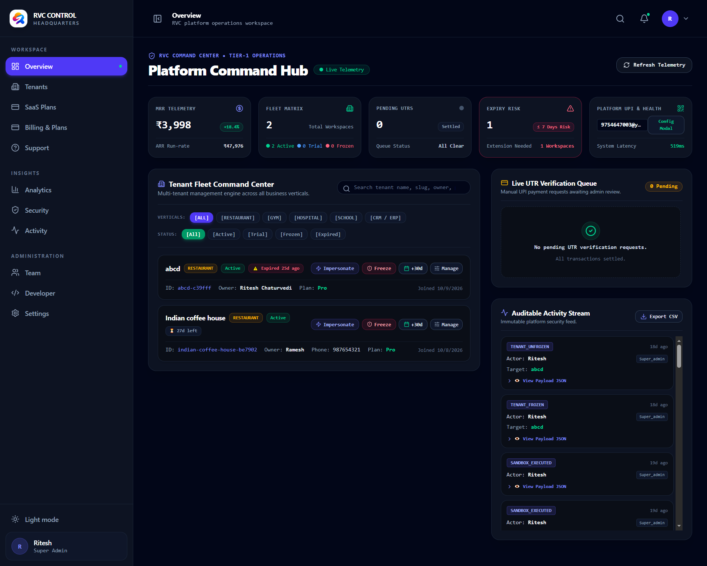

# RVC: One Platform. Every Business. Digitized.

A multi-tenant SaaS platform that gives small businesses in Tier-2 and Tier-3 Indian cities their own ready-made ERP / CRM / POS from a single sign-up. Each business gets an isolated workspace, and the platform owner manages every tenant from a central super-admin console.

**Live demo:** https://rvc-beta.netlify.app/

> Built solo, end to end: product design, database, frontend, admin tooling and tests.

## Status

| Vertical | Status |
| --- | --- |
| Restaurant POS & Digital OS | Live |
| Gym & Fitness OS | Early access |
| School & College ERP | Roadmap |
| Hospital & Clinic HIS | Roadmap |
| Real Estate & Service CRM | Roadmap |

## Screenshots

### Customer side (scan QR, order, pay)

| Menu | Confirm order | Order tracking | Feedback |
| --- | --- | --- | --- |
|  |  |  |  |

### Restaurant workspace





### Onboarding and platform



| Choose vertical | Credentials | Login |
| --- | --- | --- |
|  |  |  |

### Super-admin console



## Features

### Restaurant OS (live vertical)

**For customers (no app download)**
- Scan a table QR code to open the menu, with veg / non-veg / egg filters, bestsellers, price filters and combo suggestions
- Dine-in or takeaway ordering, cooking notes and promo codes, with GST calculated in the bill
- Live order tracking: Placed, Cooking, Ready, Served, Settled
- Call waiter, add more dishes, request the bill from the table
- Post-meal rating and feedback with highlight and improvement tags

**For the restaurant**
- Overview dashboard: revenue, live orders, table occupancy, average order value, trending dishes, recent settlements
- Live kitchen order pipeline (kitchen display)
- Tables and QR command center: add, edit and delete tables, view live table status, print QR stand cards
- Menu builder: categories, dietary tags, multi-price variants, stock availability, CSV bulk import and AI scan of paper menus
- Modules for inventory, customers, reviews, marketing, analytics, finance, staff, billing and support
- Light and dark mode

### Platform (multi-tenant layer)
- 3-step onboarding: choose business vertical, owner and business details, choose plan
- Separate workspace per business
- Super-admin console: tenant list with vertical and status filters, plan management, billing, support, team
- Tenant controls: impersonate, freeze, extend subscription
- Manual UPI payment verification queue (UTR review)
- Auditable activity stream with JSON payloads and CSV export

## Tech Stack

| Layer | Tech |
| --- | --- |
| Framework | Next.js (App Router), TypeScript |
| UI | Tailwind CSS, shadcn/ui |
| Backend / Database | Supabase (PostgreSQL, Auth, Realtime) |
| Testing | Vitest (unit), Playwright (end-to-end) |
| Tooling | pnpm, ESLint |
| Hosting | Netlify |

## Project Structure

```
app/          Next.js routes (customer, restaurant workspace, super admin, auth)
components/   Reusable UI components
lib/          Shared helpers and Supabase clients
supabase/     Database schema and migrations
tests/        Vitest and Playwright tests
public/       Static assets
```

## Getting Started

```bash
# 1. Clone
git clone https://github.com/RiteshChaturvedi07/RVC.git
cd RVC

# 2. Install dependencies
pnpm install

# 3. Configure environment
cp .env.example .env.local   # then fill in your Supabase project values

# 4. Run the dev server
pnpm dev
```

Open http://localhost:3000.

### Environment variables

| Variable | Purpose |
| --- | --- |
| `NEXT_PUBLIC_SUPABASE_URL` | Supabase project URL |
| `NEXT_PUBLIC_SUPABASE_ANON_KEY` | Supabase public (anon) key |

### Tests

```bash
pnpm test                  # unit tests (Vitest)
pnpm exec playwright test  # end-to-end tests (Playwright)
```

## Roadmap

- Gym & Fitness OS: membership expiry reminders, trainer slots
- School & College ERP: attendance, fee collection, report cards
- Hospital & Clinic HIS: OPD token queue, prescriptions, pharmacy billing
- Real Estate & Service CRM: lead pipeline, follow-ups, commission tracking

## Author

**Ritesh Chaturvedi** (Full Stack Developer, Smart India Hackathon 2024 Grand Finalist)

[LinkedIn](https://www.linkedin.com/in/ritesh-chaturvedi-050121221) | [GitHub](https://github.com/RiteshChaturvedi07) | chaturvediritesh07@gmail.com
